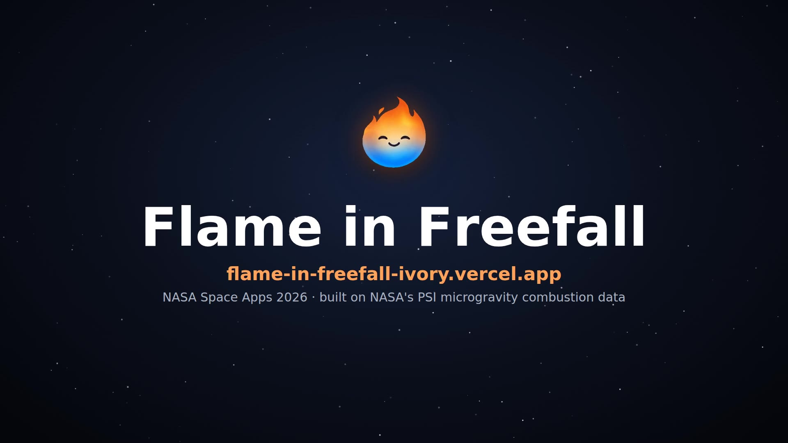
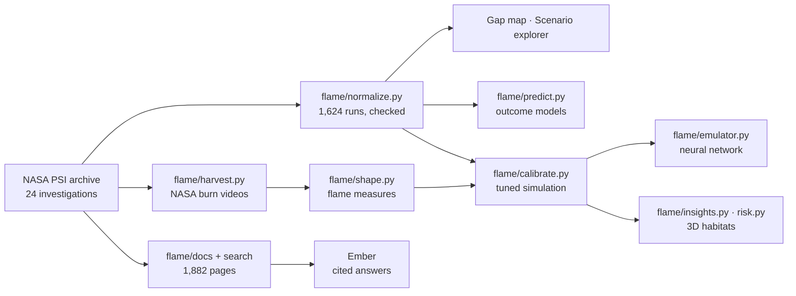

# Flame in Freefall 🔥🧑‍🚀

**NASA Space Apps Challenge 2026 · "Flame in Freefall: SI-Powered Fire Safety Insights from Microgravity Combustion Data"**



**What NASA's microgravity fire data says about the air in your habitat, and what it can't say yet.**

| | |
|---|---|
| 🌐 **Live project** | https://flame-in-freefall-ivory.vercel.app |
| ▶️ **30-second demo** | https://flame-in-freefall-ivory.vercel.app/demo.html |
| 🎞️ **Pitch deck** (fullscreen, press F) | https://flame-in-freefall-ivory.vercel.app/pitch.html |
| ✅ **How we checked every number** | https://flame-in-freefall-ivory.vercel.app/checked.html |

---

## The problem

Moon bases are planned at **30 % oxygen and 10.2 psi**, to save mass and make spacewalks easier. More oxygen means
materials ignite more easily and burn faster, and in low gravity flames don't rise: they behave unlike anything on Earth.
Yet **no solid material in NASA's public data has been burned in microgravity above 22.2 % oxygen.** NASA's fire
experiments are spread across 24 investigations, terabytes of video and hundreds of reports, each in its own format, so
it is hard to tell which results apply to a new habitat, and where designers are silently extrapolating.

## Our solution

1. **One checked dataset.** 1,624 microgravity combustion runs (633 with measured outcomes) from NASA's Physical Sciences
   Informatics archive, harmonised into one schema. Every value is traced to its source file and row, 5,123 numbers were
   re-read from the raw NASA files, and assumed or censored values are flagged on every run.
2. **Searchable findings.** 1,882 NASA report pages and paper abstracts, indexed so answers can cite file and page.
3. **A flame simulation tuned on NASA.** A 2D fluid and combustion simulation (browser WebGL + a PyTorch GPU port),
   with its physics fitted to NASA gas-flame outcomes, flame shapes measured from NASA videos, and solid
   burn-or-out cases, scored on test days it never saw.
4. **A neural network** trained on 20,000 runs of the tuned simulation, so the site predicts a flame instantly.
5. **Data-driven outcome models** (gradient-boosted trees) for gas flames and droplets, cross-validated by test day.

## Demo: what you can do

- **Gap map:** every NASA test on one chart of oxygen vs. pressure; the planned habitats sit in the empty zone.
- **Scenario explorer:** pick ISS, Moon base, a spacesuit… or set the air yourself; get the closest real experiments,
  a plain verdict on how well data covers it, the flame simulation next to real NASA footage, and a model prediction.
- **Flame lab:** change gravity, oxygen and airflow and watch the flame's shape change, live.
- **3D station and habitats:** fly to the ISS and a Moon base, look inside, **inspect and ignite** objects: the fire
  spreads over the 3D model at the model's speed; cut the fans and see what happens.
- **Ask Ember:** a research assistant that answers only from NASA's run tables, reports and papers, and cites them.

## How it works



## How far to trust it

Every number on the site says how it was tested. Full reports: [`dataset/predict_eval.md`](dataset/predict_eval.md),
[`dataset/shape_eval.md`](dataset/shape_eval.md), [`dataset/spread_eval.md`](dataset/spread_eval.md),
[`dataset/loo_eval.md`](dataset/loo_eval.md), and the [How we checked](https://flame-in-freefall-ivory.vercel.app/checked.html) page.

| What | Result | How it was tested |
|---|---|---|
| Gas flame: lights / goes out / still burning (data model) | 0.58 balanced accuracy (guessing 0.33) | 5-fold cross-validation by NASA test day |
| Gas flame: seconds until it goes out (data model) | typically within ×1.42 (guessing ×2.67) | same |
| Droplet burning rate (data model) | 0.040 mm²/s error (guessing 0.095) | same |
| Solid fire: keeps burning or goes out (tuned simulation) | 30 of 31 NASA cases | leave-one-out |
| Flame spread speed | 6 of 7 NASA targets fitted, 2 of 7 unseen | fit / leave-one-out |
| Neural network vs. the simulation | 99.4 % (lights?) · 97.9 % (goes out?) | 2,000 held-out simulations |

**What we don't claim:** gas-flame outcomes from the simulation are no better than guessing, so those numbers come from
the data models. Flame shapes in the simulator are illustrative. Every NASA run is microgravity: Moon and Earth gravity
effects are physics, not data. Spread between objects uses standard fire-engineering estimates, not NASA data.

## NASA data and resources

- **NASA Physical Sciences Informatics (PSI)**, https://psi.nasa.gov: run tables, file manifests and burn videos of
  PSI-69 FLEX, PSI-39 CFI, PSI-159 ACME CFI-G, PSI-10 ACME Flame Design, PSI-107 SPICE, PSI-25 BASS-II and PSI-98/99/100
  SAFFIRE I–III (9 investigations with run data), plus metadata of 15 more combustion investigations.
- **NASA final reports** in PSI (40 PDFs), notably the *BASS-II Summary Report* NASA/TM-20210011385.
- **NASA Technical Reports Server**, https://ntrs.nasa.gov, and 299 linked papers (`dataset/publications.json`).
- Habitat atmospheres: the challenge brief and NASA's Exploration Atmospheres Working Group recommendation.

## Repository map

```
dataset/        the checked dataset (flame_runs.json/.csv), search corpus, evaluation reports   ← start here
flame/          Python pipeline: fetch → normalize → search, simulation, measures, calibration, models
public/         the website (static, Vercel CDN): index, pitch, demo, checked, station/ (3D, flame lab, habitats)
app/            FastAPI backend (/api/*) and Ember, the cited assistant
ranking/        investigation ranking per habitat and fire-safety pillar
demo/           Remotion project that renders the 30-second demo video
docs/           models.md (how the models work), media.md (NASA video), submission.md
AGENTS.md       how to load and use the dataset (for people and AI agents)
```

## Run it

```bash
pip install -r requirements.txt fastapi uvicorn
uvicorn app.main:app --reload                 # http://localhost:8000
# Ember needs DEEPSEEK_API_KEY in .env

python3 -m flame.fetch && python3 -m flame.normalize     # rebuild the dataset from NASA PSI (checks run at the end)
python3 -m flame.predict                                   # outcome models + cross-validation report
python3 -m flame.calibrate --gens 36                       # tune the simulation (GPU, ~3 h)
python3 -m flame.emulator --n 20000                        # train the neural network
```
Details: [`AGENTS.md`](AGENTS.md) (dataset) and [`docs/models.md`](docs/models.md) (models).

## Team

Alex (dataset, models, website), Kai (investigation ranking), Mario (3D station), Sophia (NASA video dataset).

## Use of AI

- **Claude Code** (Anthropic) helped write code, data processing and documentation; the team directed and reviewed it.
- **Ember** answers with DeepSeek, grounded in retrieved NASA documents and required to cite them.
- **Higgsfield** generated the Ember character art and the 3D object models; **ElevenLabs** voiced the demo video.
  The demo's background music was generated in code (`demo/tools/music.py`).
- The flame neural network is our own, trained on our own simulation output.

All NASA data, reports and footage are NASA's (public domain); every number on the site links back to its NASA source.
